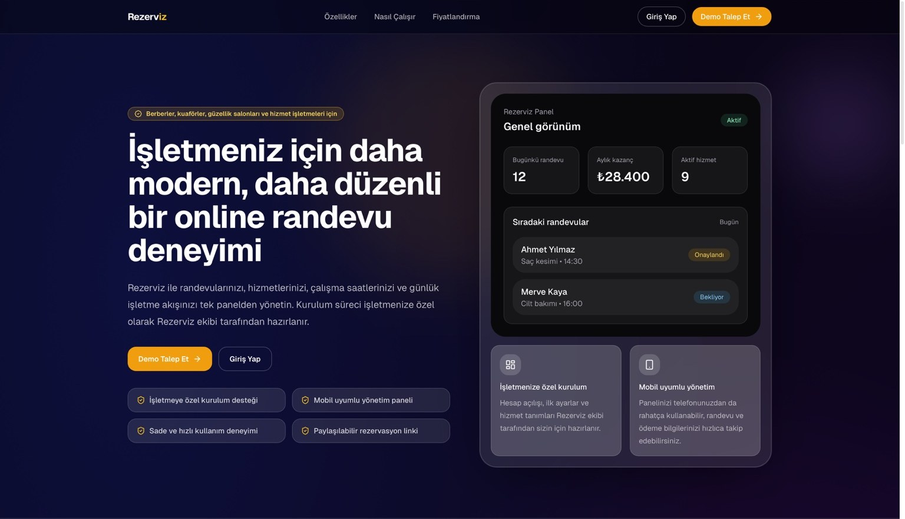
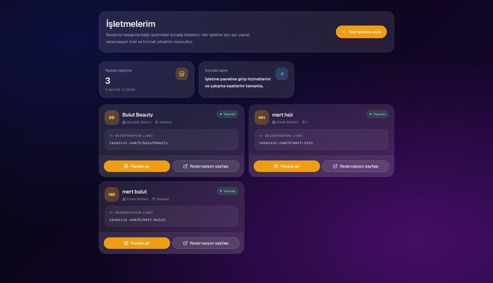
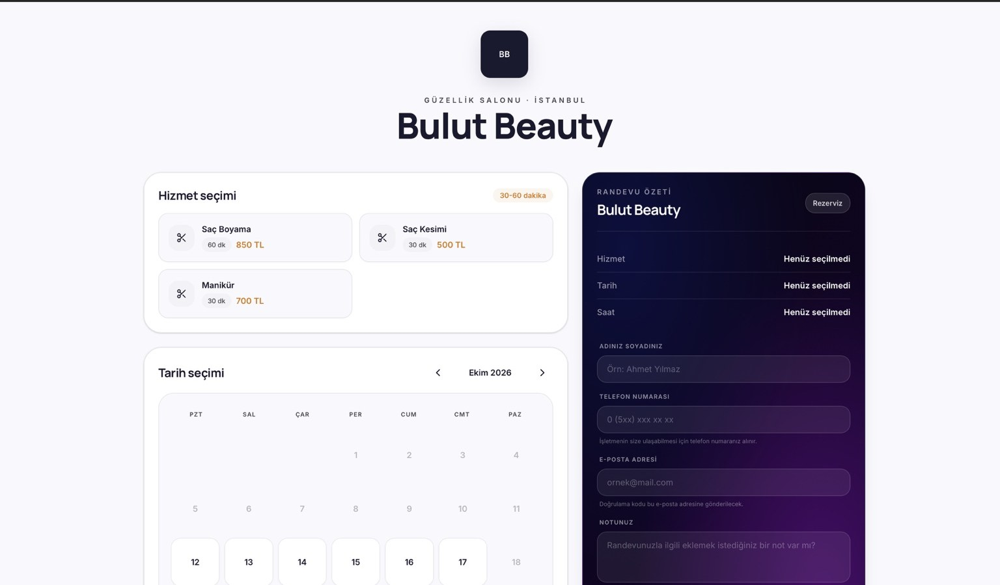
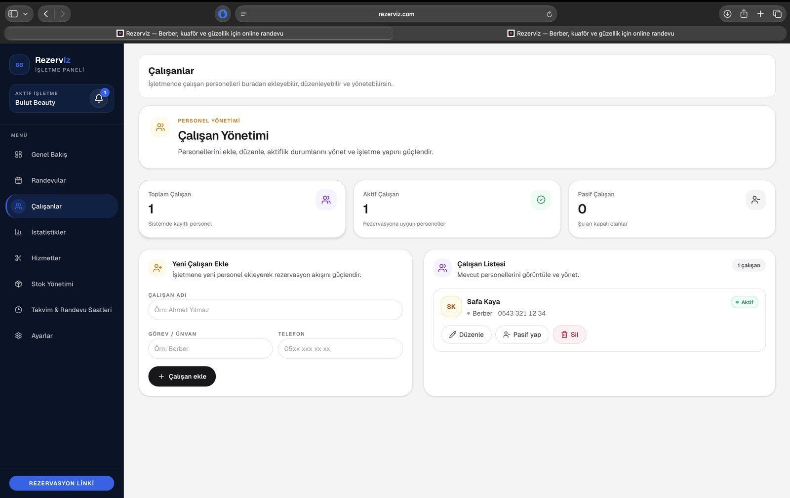
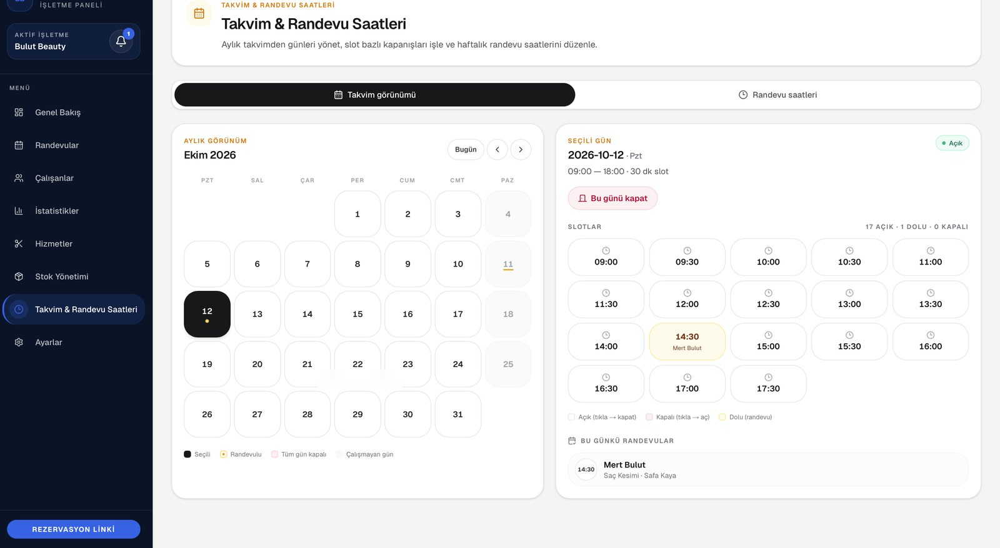
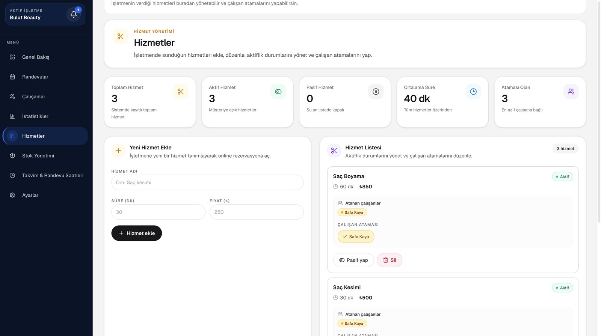
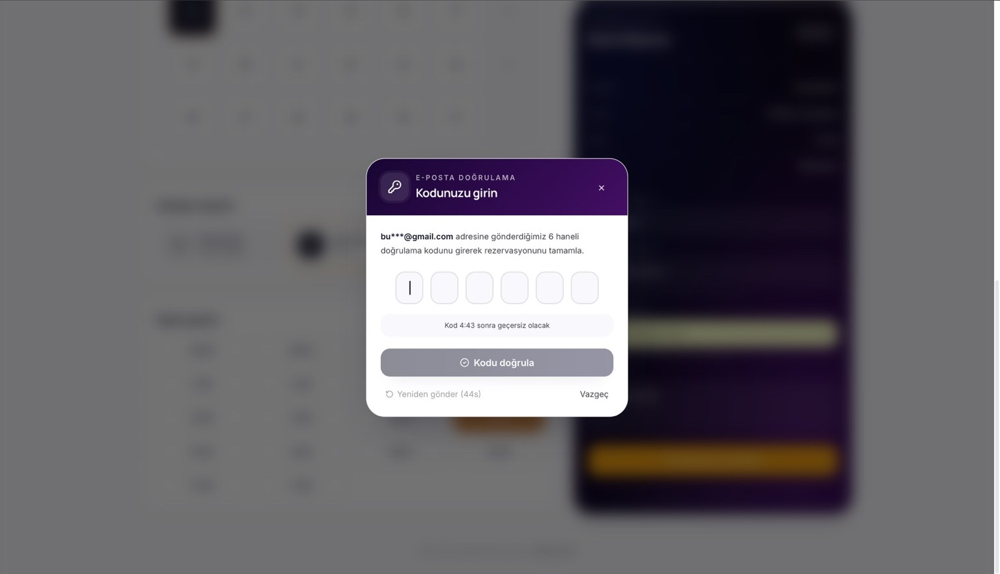

# Rezerviz — SaaS Randevu ve İşletme Yönetim Platformu

**Ürün geliştirme portföyü · 2026 · 2 kişilik ekip**

Rezerviz, randevuyla çalışan küçük hizmet işletmelerinin müşteri rezervasyonlarını, personelini, hizmetlerini ve günlük operasyonlarını tek bir panelde yönetebilmesi için geliştirdiğimiz bir SaaS prototipidir.

> **Proje durumu:** İlk geliştirme sürümü tamamlandı; ticari kullanıma açılmadı. Bu depo bir **ürün tanıtımıdır**; uygulama kaynak kodu ayrı bir özel depoda tutulmaktadır. Görseller yerel geliştirme ortamından alınmıştır; gerçek müşteri verisi kullanılmamıştır.

## Üründen ekranlar

### 1. Ürün ana sayfası

### 2. Çoklu işletme yönetimi
Bir hesaba bağlı işletmeleri görüntüleme ve her işletmenin paneline veya rezervasyon sayfasına erişme.

### 3. Müşteri rezervasyon deneyimi
Hizmet, tarih ve saat seçimi; rezervasyon bilgilerinin girilmesi ve talep akışı.

### 4. Takvim ve müsaitlik yönetimi
İşletmenin gün ve saat bazında uygunluk durumunu izlemesi; dolu ve açık slotların ayrıştırılması.

### 5. Personel yönetimi
Çalışan kaydı, aktiflik durumu ve personel listesi.

### 6. Hizmet yönetimi
Hizmet süresi ve ücretlerinin tanımlanması; hizmetlerin personele atanması.

### 7. E-posta doğrulama akışı
Rezervasyon oluşturma sürecinde doğrulama kodu arayüzü.

## Çözülen problem

Manuel randevu takibi; çalışan müsaitliği, hizmet süreleri ve çakışmaların kontrolünü zorlaştırır. Rezerviz, müşterinin çevrim içi rezervasyon oluşturması ile işletmenin operasyonları tek panelden yönetmesini aynı veri modeli etrafında birleştirir.

## Temel özellikler

- İşletme, çalışan ve hizmet yönetimi
- Çalışma saatleri ve randevu slotları
- Müşteri rezervasyon akışı ve e-posta doğrulama
- Müsaitlik ve çakışma kontrolleri
- Kimlik doğrulama ve yetkilendirme
- Yönetim paneli, bildirim ve stok yönetimi işlevleri

## Teknoloji yığını

| Katman | Teknolojiler |
| --- | --- |
| Arayüz | Next.js (App Router), React, TypeScript, Tailwind CSS |
| Sunucu / API | Next.js Route Handlers, HTTP API uç noktaları |
| Veri ve kimlik doğrulama | PostgreSQL, Supabase, Supabase Auth |
| Sürüm kontrolü | Git, GitHub |
| Dağıtım çalışmaları | Vercel, Cloudflare |

**Yüksek seviyeli mimari:** Müşteri rezervasyon ekranı / işletme paneli → Next.js uygulaması ve sunucu API'leri → Supabase Auth ve PostgreSQL.

## Projedeki katkım

İki kişilik geliştirme ekibinde farklı aşamalarda görev aldım. Özellikle ilişkisel veri modeli tasarımı, Supabase/PostgreSQL entegrasyonu, kullanıcı yetkilendirmesi ve veri erişim güvenliği üzerinde çalıştım. Rezervasyon akışları, müsaitlik kontrolleri, yönetim paneli ve test süreçlerine de katkı sağladım.

## Ürün geliştirme kazanımları

İşletme ihtiyaçlarını işlevsel gereksinimlere dönüştürme, müşteri ve işletme kullanıcı akışlarını tasarlama, veri modelini operasyonel kurallarla ilişkilendirme ve küçük ekipte uçtan uca ürün geliştirme.

## Kaynak kodu ve güvenlik

Bu depo **yalnızca portföy sunumu** içerir. Kaynak kodu, `.env` dosyaları, API anahtarları ve veri tabanı dökümleri paylaşılmaz. Görsellerde örnek/test verileri kullanılmıştır. Canlı demo şu anda sunulmamaktadır.
